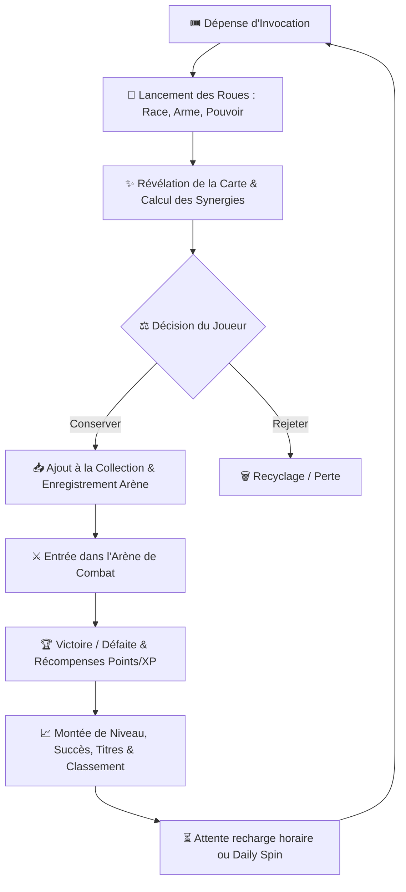
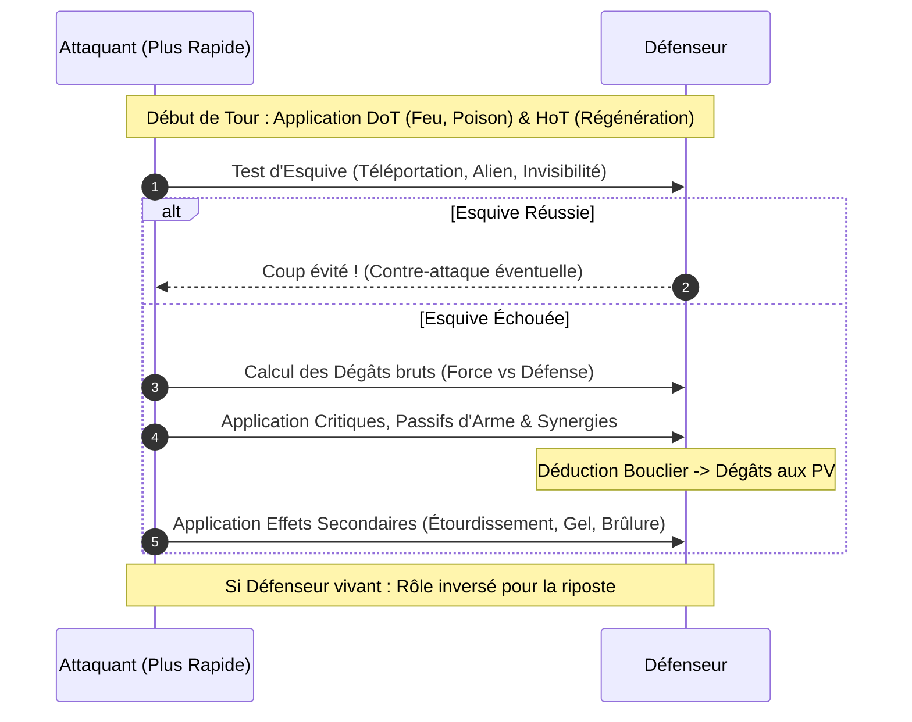

# 📜 WHEELBORN (RNGboy) — Document de Game Design & Spécifications Techniques

> **Version :** 1.0.0  
> **Statut :** Prototype de validation gameplay (Vite/JS) en vue d'un portage **Laravel 11 + Livewire 3 + Tailwind CSS**  
> **Auteur :** Équipe de conception & Développement  

---

## Sommaire

1. [Vision Globale & Objectifs](#1-vision-globale--objectifs)
2. [Game Design Document (GDD)](#2-game-design-document-gdd)
   - [2.1. Boucle de Jeu Principale (Core Loop)](#21-boucle-de-jeu-principale-core-loop)
   - [2.2. Les Piliers de la Génération : Roues & Caractéristiques](#22-les-piliers-de-la-génération--roues--caractéristiques)
   - [2.3. Formules Mathématiques des Statistiques & Score Power](#23-formules-mathématiques-des-statistiques--score-power)
   - [2.4. Système de Rareté & Scarcity](#24-système-de-rareté--scarcity)
   - [2.5. Catalogue des Synergies & Combinaisons Instables](#25-catalogue-des-synergies--combinaisons-instables)
   - [2.6. Régulation des Tirages & Invocations](#26-régulation-des-tirages--invocations)
   - [2.7. Moteur de Combat Tour par Tour](#27-moteur-de-combat-tour-par-tour)
   - [2.8. Matchmaking, Arène & Pool Communautaire](#28-matchmaking-arène--pool-communautaire)
   - [2.9. Progression, Succès & Classement](#29-progression-succès--classement)
3. [Système Visuel Futur : Moteur d'Assemblage Modulaire d'Assets](#3-système-visuel-futur--moteur-dassemblage-modulaire-dassets)
   - [3.1. Approche "Paper Doll" / Calques d'Assets](#31-approche-paper-doll--calques-dassets)
   - [3.2. Hiérarchie des Couches Graphiques](#32-hiérarchie-des-couches-graphiques)
   - [3.3. Pipeline d'Intégration](#33-pipeline-dintégration)
4. [Architecture Technique du Prototype Actuel (JavaScript)](#4-architecture-technique-du-prototype-actuel-javascript)
   - [4.1. Cartographie des Fichiers & Rôles](#41-cartographie-des-fichiers--rôles)
   - [4.2. Schéma de Données (JSON Models)](#42-schéma-de-données-json-models)
   - [4.3. Déterminisme & Reproductibilité (PRNG)](#43-déterminisme--reproductibilité-prng)
5. [Spécifications pour le Portage Laravel + Livewire + Tailwind](#5-spécifications-pour-le-portage-laravel--livewire--tailwind)
   - [5.1. Schéma de Base de Données (Migrations & Modèles Eloquent)](#51-schéma-de-base-de-données-migrations--modèles-eloquent)
   - [5.2. Services Métiers PHP Purs](#52-services-métiers-php-purs)
   - [5.3. Découpage des Composants Livewire 3 + Alpine.js](#53-découpage-des-composants-livewire-3--alpinejs)
   - [5.4. Charte Graphique & Tokens Tailwind CSS](#54-charte-graphique--tokens-tailwind-css)
6. [Audit Critique & Pistes d'Amélioration Gameplay](#6-audit-critique--pistes-damélioration-gameplay)
   - [6.1. Points Forts du Prototype](#61-points-forts-du-prototype)
   - [6.2. Limites Identifiées & Axes d'Équilibrage](#62-limites-identifiées--axes-déquilibrage)
   - [6.3. Idées d'Itérations Immédiates](#63-idées-ditérations-immédiates)

---

## 1. Vision Globale & Objectifs

### 1.1. Philosophie du Projet
**WHEELBORN** est un jeu hybride combinant :
- L'excitation de l'invocation aléatoire (style *Gacha / Slot Machine*) ;
- La collection stratégique de cartes et l'évaluation de profils d'attributs ;
- La découverte de combinaisons secrètes et de synergies thématiques ;
- Des combats automatiques tactiques (autobattler 1v1) fondés sur les stats et passifs, sans être une simple loterie binaire ;
- Une économie et une régulation du temps créant de la rareté et du désir.

### 1.2. Rôle du Prototype Actuel
Ce projet en JavaScript natif (avec Vite) sert de **bac à sable fonctionnel**. Son rôle est de valider mathématiquement et ludiquement :
1. La sensation de tirage des roues (satisfaction, suspense, lisibilité) ;
2. La viabilité de l'équilibrage des statistiques et du score Power ;
3. La pertinence tactique des synergies en combat ;
4. Le cycle de rétention du joueur (tirages réguliers, combats, classement).

Une fois validé et ajusté, l'ensemble des règles sera migré vers une application web robuste sous **Laravel 11 + Livewire 3 + Tailwind CSS**, avec persistance en base relationnelle, multijoueur asynchrone réel et moteur de rendu visuel par assets superposés.

---

## 2. Game Design Document (GDD)

### 2.1. Boucle de Jeu Principale (Core Loop)



### 2.2. Les Piliers de la Génération : Roues & Caractéristiques

Chaque personnage est forgé à partir de **trois composantes fondamentales**, complétées par des jets de statistiques.

#### A. Les 8 Races
Chaque race définit l'identité corporelle, oriente les statistiques et confère un passif distinct :

| Race | Icône | Modificateurs Stats | Passif Thématique | Pondération |
| :--- | :---: | :--- | :--- | :---: |
| **Humain** | 👤 | +5 PV, +5 Force, +5 Vitesse, +5 Défense | *Adaptabilité* : Bonus universel équilibré. | 20 |
| **Elfe** | 🧝 | -2 PV, +2 Force, +18 Vitesse, -10 Défense | *Grâce Sylvestre* : Initiative et vélocité extrêmes. | 15 |
| **Démon** | 😈 | +4 PV, +20 Force, +6 Vitesse, -12 Défense | *Fureur Infernale* : Frappe massive, défense vulnérable. | 12 |
| **Robot** | 🤖 | +12 PV, +6 Force, -14 Vitesse, +22 Défense | *Châssis Titane* : Blindage lourd, pénalité de vitesse. | 12 |
| **Mutant** | ☣️ | 0 partout (Base) + Variance [-12, +20] | *Génome Chaotique* : Tirages imprévisibles par stat. | 10 |
| **Golem** | 🗿 | +25 PV, +12 Force, -22 Vitesse, +25 Défense | *Écorce Rocheuse* : Sac de PV et armure colossale. | 10 |
| **Vampire** | 🧛 | -4 PV, +14 Force, +10 Vitesse, -6 Défense | *Soif de Sang* : Vole 12% des dégâts infligés en PV. | 11 |
| **Alien** | 👽 | +6 PV, +8 Force, +8 Vitesse, +6 Défense | *Biologie Stellaire* : +8% d'esquive innée et synergies cosmiques. | 10 |

#### B. Les 8 Armes
L'arme modifie les statistiques d'attaque et apporte un effet tactique en combat :

| Arme | Icône | Type | Modificateurs Stats | Effet Passif en Combat | Poids |
| :--- | :---: | :--- | :--- | :--- | :---: |
| **Épée** | ⚔️ | Mêlée | +12 Force, +4 Vitesse, +6 Défense | Équilibrée et robuste. | 15 |
| **Arc** | 🏹 | Distance | +6 Force, +16 Vitesse, -2 Défense | Maximise les chances d'initiative. | 15 |
| **Marteau** | 🔨 | Lourd | +5 PV, +24 Force, -12 Vitesse, +8 Défense | 25% de chance d'étourdir l'adversaire (passe son tour). | 12 |
| **Lance** | 🔱 | Allonge | +2 PV, +10 Force, +10 Vitesse, +4 Défense | *Estoc fulgurant* : +25% de dégâts au tout 1er coup porté. | 14 |
| **Dague** | 🗡️ | Furtif | -2 PV, +8 Force, +20 Vitesse, -4 Défense | *Opportunisme* : +30% de dégâts si plus rapide que la cible. | 12 |
| **Bâton** | 🪄 | Magie | +8 PV, +6 Force, +6 Vitesse, +6 Défense | Amplifie les soins et boucliers arcaniques (+25%). | 12 |
| **Pistolet** | 🔫 | Balistique | +14 Force, +12 Vitesse, -4 Défense | *Précision* : 25% de coup critique (dégâts ×1.75). | 11 |
| **Grimoire**| 📖 | Incantation| +16 Force, +2 Vitesse, +2 Défense | *Magie Primordiale* : +35% sur les effets élémentaires. | 11 |

#### C. Les 8 Pouvoirs
Le pouvoir octroie une capacité spéciale active déclenchée pendant le combat :

| Pouvoir | Icône | Type | Effet de Combat | Poids |
| :--- | :---: | :--- | :--- | :---: |
| **Feu** | 🔥 | Élémentaire | DoT de Brûlure : 8 dégâts continus par tour pendant 3 tours. | 15 |
| **Glace** | ❄️ | Élémentaire | Ralentit la vitesse ennemie de 35% + 15% de chance de gel total. | 14 |
| **Poison** | 🧪 | Toxique | DoT progressif : inflige 5, puis 10, puis 15 dégâts sur 3 tours. | 14 |
| **Foudre** | ⚡ | Élémentaire | Surtension : +35% de chance de critique (dégâts ×1.8). | 13 |
| **Gravité** | 🌌 | Cosmique | Écrase la cible : -45% de vitesse adverse et -15% de ses dégâts. | 11 |
| **Téléportation** | 🌀 | Spatial | *Saut Dimensionnel* : 28% de chance d'esquiver complètement un coup. | 11 |
| **Régénération** | 💖 | Vital | Restaure automatiquement +12 PV au début de chaque tour. | 12 |
| **Invisibilité** | 👁️‍🗨️| Furtif | Dissimulation : esquive 100% garantie du tout premier coup reçu. | 10 |

---

### 2.3. Formules Mathématiques des Statistiques & Score Power

#### 1. Tirage de Base (Base Stats)
Avant tout modificateur, chaque statistique est générée dans une fourchette aléatoire uniforme :
- **PV de base :** $[55 ; 75]$
- **Force de base :** $[45 ; 70]$
- **Vitesse de base :** $[40 ; 68]$
- **Défense de base :** $[42 ; 68]$

#### 2. Calcul des Statistiques Finales
$$\text{Stat Finale} = \text{Base} + \text{Mod Race} + \text{Mod Arme} + \text{Bonus Synergies} + \text{Variance Mutant}$$
*Bornes de sécurité appliquées :*
- $\text{PV} \in [30 ; 130]$
- $\text{Force} \in [15 ; 100]$
- $\text{Vitesse} \in [10 ; 100]$
- $\text{Défense} \in [10 ; 100]$

#### 3. Calcul du Score Global (POWER)
Le score Power résume l'efficacité martiale du personnage sur une échelle normalisée (environ 40 à 98) :
$$\text{Power} = \text{Arrondi}\Big((\text{Force} \times 0.32) + (\text{PV} \times 0.24) + (\text{Défense} \times 0.24) + (\text{Vitesse} \times 0.20) + (\text{Nb Synergies} \times 3) + (\text{Bonus Instable } ?\ 2 : 0)\Big)$$

#### 4. Estimation de Valeur Marchande / Prestige
$$\text{Valeur (Coins)} = \text{Arrondi}\Big(\big((\text{Power} \times 8) + (\text{Synergies} \times 45) + (\text{Victoires} \times 15) + (\text{Instable } ?\ 60 : 0)\big) \times \text{Multiplicateur Rareté}\Big)$$

---

### 2.4. Système de Rareté & Scarcity

La rareté suit une véritable logique de collection. Les raretés légendaires ne doivent pas être banales.

| Rareté | Étoiles | Couleur | Mult. Valeur | Taux Standard | Taux Quotidien (Daily) |
| :--- | :---: | :---: | :---: | :---: | :---: |
| **Commun** | ★☆☆☆☆ | Gris ardoise (`#94a3b8`) | $\times 1.00$ | **72 %** | **48 %** |
| **Rare** | ★★☆☆☆ | Bleu cyan (`#38bdf8`) | $\times 1.15$ | **21 %** | **34 %** |
| **Épique** | ★★★☆☆ | Violet mystique (`#c084fc`)| $\times 1.30$ | **6 %** | **14 %** |
| **Légendaire** | ★★★★★ | Or incandescent (`#fbbf24`)| $\times 1.50$ | **1.0 %** | **4.0 %** |

*Règle d'ajustement de cohérence :* Si un personnage génère un Power $\ge 86$ avec au moins 2 synergies mais a tiré un ticket Commun, il est promu automatiquement au rang *Rare* (et au rang *Épique* si Power $\ge 95$).

---

### 2.5. Catalogue des Synergies & Combinaisons Instables

Le jeu intègre **16 synergies uniques** qui récompensent les associations cohérentes ou insolites :

#### Synergies Harmoniques (12)
1. **Démon + Feu** (*Affinité Démoniaque*) : +18% Dégâts globaux, DoT de Brûlure amplifié de +50%.
2. **Elfe + Arc** (*Archer Naturel*) : +16 Vitesse, +20% chance de coup critique.
3. **Robot + Foudre** (*Supraconducteur*) : +15 Défense, chaque frappe électrique ennemie recharge 6 PV au lieu de nuire.
4. **Vampire + Régénération** (*Sangsue Immortelle*) : Soin passif doublé (+12 PV/tour) et vol de vie élevé à 25%.
5. **Golem + Marteau** (*Impact Tellurique*) : +25 Force, 40% de chance d'étourdissement lourd.
6. **Grimoire + Magie Élémentaire** (*Incantation Arcanique*) : +25% d'efficacité magique et +1 tour de durée sur les DoT.
7. **Humain + Épée** (*Maître d'Armes*) : +12 Force, +12 Défense, parade réduisant de 10% tous les dégâts reçus.
8. **Alien + Téléportation** (*Distorsion Spatiale*) : +30% d'esquive globale et contre-attaque spatiale automatique à chaque esquive réussie.
9. **Dague + Invisibilité** (*Assassin Fantôme*) : +12 Vitesse, premier coup critique garanti à $\times 2.2$ de dégâts.
10. **Bâton + Régénération** (*Harmonie Sylvestre*) : Bouclier arcanique de 25 PV offert en début de duel et +8 PV soignés par tour.
11. **Pistolet + Foudre** (*Tir Électro-Magnétique*) : +25% critique, multiplicateur critique porté à $\times 2.0$.
12. **Lance + Gravité** (*Pointe Gravitationnelle*) : Cloue l'ennemi au sol (l'adversaire ne peut jamais esquiver) et +15% dégâts.

#### Combinaisons Instables (4)
13. **Démon + Glace** (*Combustion Glacée*) : Choc thermique imprévisible. Dégâts variant sauvagement entre 50% et 220% à chaque coup, et inflige à la fois Brûlure et Gel.
14. **Robot + Poison** (*Infection Artificielle*) : Liquide de refroidissement toxique qui ronge la défense ennemie (-30%), mais le robot subit une corrosion interne de 4 PV/tour.
15. **Golem + Téléportation** (*Masse Déplacée*) : +20% d'esquive par disparition. À sa réapparition, le colosse de 10 tonnes retombe et écrase l'ennemi en infligeant 30 dégâts bonus nets.
16. **Mutant + Gravité** (*Singularité Vivante*) : Anomalie biologique. La force et la vitesse du personnage mutent de façon aléatoire à chaque tour de combat ($-10$ à $+20$).

---

### 2.6. Régulation des Tirages & Invocations

Pour prévenir la lassitude du "clic infini" et créer de la valeur émotionnelle autour de chaque personnage :
1. **Charges Horaires :** Le joueur dispose d'une réserve de **2 charges maximum**. Une charge se régénère toutes les **60 minutes** (3 600 secondes).
2. **Personnage du Jour (Daily) :** Un tirage d'élite disponible toutes les **24 heures**, offrant un taux de Légendaires quadruplé (4%) et un don immédiat de **+200 Points**.
3. **Capacité de Collection :** Limitée à **150 personnages**, forçant à arbitrer entre garder, remplacer ou recycler.

---

### 2.7. Moteur de Combat Tour par Tour

Le combat oppose deux combattants en 1 contre 1, résolu automatiquement en tours successifs (plafond à 30 tours pour éviter tout blocage).



#### Formule de Dégâts de Base
$$\text{Dégâts Bruts} = \max\Big(5,\ (0.75 \times \text{Force}_{\text{attaquant}} - 0.38 \times \text{Défense}_{\text{défenseur}}) + \text{Aléatoire}(-3, +3)\Big) \times \text{Multiplicateurs}$$

- **Initiative :** Calculée dynamiquement à chaque tour en comparant la vitesse actuelle. Un combattant affecté par un gel ou un ralentissement peut perdre l'initiative au cours du match.
- **Boucliers :** Absorbent les dégâts avant que les PV ne soient entamés.
- **Contrôles de foule :** L'étourdissement du Marteau ou le gel complet neutralisent l'action du tour.

---

### 2.8. Matchmaking, Arène & Pool Communautaire

Pour rendre les combats stimulants :
1. **Priorité aux Cartes des Vrais Joueurs :** Dès qu'un joueur sauvegarde un personnage, il est injecté dans le pool communautaire (avec nom de créateur `👤 MonPseudo`).
2. **Matchmaking par Tranche de Power :** Le système recherche un adversaire ayant un écart de Power de $\pm 10$ points pour garantir des duels disputés.
3. **Bots d'Arène de Secours :** Si aucune carte joueur n'est disponible dans la tranche, un combattant fictif d'arène (`🤖 Bot Arène`) est généré à la volée.
4. **Trois Modes de Combat :**
   - **Mode Rapide :** Matchmaking direct contre un rival équilibré.
   - **Défis d'Arène :** Choix parmi 3 adversaires (Facile, Équilibré, Boss Redoutable avec multiplicateur de récompense).
   - **Duel Collection :** Fait s'affronter deux cartes du même joueur pour tester laquelle est la plus puissante.

---

### 2.9. Progression, Succès & Classement

- **Gains de Points :**
  - Victoire : $+100$ points (majoré d'un bonus *Underdog* si l'adversaire avait un Power supérieur : $\Delta \text{Power} \times 4$).
  - Défaite : $+25$ points d'encouragement.
  - Quotidien : $+200$ points.
- **Niveaux & XP :** 7 paliers menant du statut d'*Apprenti des Roues* à *Légende du Destin*.
- **Succès Déblocables (8) :**
  - *Premier Sang*, *Maître des Combats* (10 victoires), *Collectionneur Novice* (10 cartes), *Découvreur de Synergies*, *Béni des Dieux* (Carte Légendaire), *Tueur de Colosse* (vaincre un rival avec +12 Power), *Instabilité Chimique* (activer une combinaison instable), *Grand Champion* (Niveau 5).
- **Classement Dynamique :** Tableau affichant les rivaux et intégrant le joueur en temps réel selon son total de points.

---

## 3. Système Visuel Futur : Moteur d'Assemblage Modulaire d'Assets

Comme indiqué dans vos spécifications, les cartes n'ont pas encore d'illustrations définitives. L'objectif est d'utiliser un **système de génération visuelle modulaire 2D par calques (Paper Doll)**.

### 3.1. Approche "Paper Doll" / Calques d'Assets

Plutôt que de dessiner des centaines d'illustrations complètes, vous dessinerez des **éléments isolés sur fond transparent (PNG / WebP / SVG)** calibrés sur un gabarit (canvas) standardisé (ex: $600 \times 800$ px).

```text
Nombre de combinaisons possibles = 
  8 (Races) × 8 (Armes) × 8 (Pouvoirs) × 4 (Raretés) = 2 048 visuels uniques
... réalisables avec seulement ~35 assets dessinés !
```

### 3.2. Hiérarchie des Couches Graphiques (Z-Index)

```
[Couche 6 - Premier Plan] : Bordure & Cadre de Rareté (Doré, Violet, Bleu, Gris)
[Couche 5 - Effets]       : Aura / Particules de Pouvoir (Flammes, Éclairs, Particules de Glace)
[Couche 4 - Main / Arme]  : Arme équipée (Arc bandé, Épée levée, Bâton lumineux)
[Couche 3 - Équipement]   : Vêtements, Armure ou Accessoires spécifiques
[Couche 2 - Corps / Race] : Silhouette de base de la Race (Humain, Golem de pierre, Robot, Démon ailé)
[Couche 1 - Arrière-Plan] : Fond thématique (Arène, Forêt elfique, Crypte, Cosmos)
```

### 3.3. Pipeline d'Intégration

Trois méthodes sont envisageables pour la version Livewire :

1. **Option A : Superposition CSS pure (Recommandée pour Livewire + Tailwind)**
   - Le composant Blade affiche un conteneur relatif contenant plusieurs `` absolus superposés :
   ```html
   <div class="relative w-64 h-96 rounded-xl overflow-hidden shadow-2xl">
       rarity }}.webp" class="absolute inset-0 z-0">
       raceId }}.webp" class="absolute inset-0 z-10">
       weaponId }}.webp" class="absolute inset-0 z-20">
       powerId }}.webp" class="absolute inset-0 z-30">
       rarity }}.webp" class="absolute inset-0 z-40 pointer-events-none">
   </div>
   ```
   *Avantages :* Zéro calcul serveur, rendu instantané, animations CSS/Tailwind indépendantes sur chaque calque (ex: aura qui pulse).

2. **Option B : Rendu HTML5 Canvas Client**
   - Fusionne les images en une seule texture via un canvas JavaScript et permet le téléchargement de la carte par le joueur en PNG.

3. **Option C : Génération Serveur (Intervention Image en PHP)**
   - Fusionne les calques côté serveur lors de la sauvegarde du personnage et stocke une miniature unique sur S3/Local Storage.

---

## 4. Architecture Technique du Prototype Actuel (JavaScript)

### 4.1. Cartographie des Fichiers & Rôles

```
c:\Users\natha\Documents\PROJET\RNGboy\
├── index.html                   # Shell applicatif sémantique et conteneurs de vues
├── package.json                 # Environnement Vite
└── src/
    ├── main.js                  # Point d'entrée, cycle de vie, routage par onglets
    ├── style.css                # Design system complet (thème sombre, néon, animations)
    ├── data/
    │   ├── config.js            # Table de probabilités, paramètres d'énergie et XP
    │   ├── races.js             # Objets des 8 races et modificateurs
    │   ├── weapons.js           # Objets des 8 armes et effets tactiques
    │   ├── powers.js            # Objets des 8 pouvoirs et DoT/HoT
    │   ├── synergies.js         # Conditions et bonus des 16 synergies
    │   └── names.js             # Générateur procédural de noms
    ├── utils/
    │   ├── random.js            # Algorithme PRNG Mulberry32 et choix pondérés
    │   └── sound.js             # Synthétiseur audio pur Web Audio API (sans fichiers MP3)
    ├── generation/
    │   ├── characterGenerator.js# Calcul des stats, power, rareté et instanciations
    │   └── massSimulator.js     # Outil de test sur 1 000 tirages consécutifs
    ├── combat/
    │   ├── battleEngine.js      # Moteur de combat tour par tour autonome
    │   └── opponentsPool.js     # Gestionnaire du pool communautaire et des bots
    ├── collection/
    │   └── collectionManager.js # CRUD de collection et persistance localStorage
    ├── progression/
    │   └── progressionManager.js# Gestion des charges horaires, XP, succès et classements
    └── ui/
        ├── wheelUI.js           # Rouleaux de tirage et compteurs d'invocations
        ├── characterCardUI.js   # Rendu réutilisable des fiches de cartes
        ├── collectionUI.js      # Grille, filtres, recherche et modale de détail
        ├── battleUI.js          # Arène de combat, logs défilants et jauges de PV
        ├── devUI.js             # Panneau de triche, simulation 1000 et debug
        ├── extrasUI.js          # Vues Daily, Classement et Statistiques
        └── notifications.js     # Système de toasts d'information
```

### 4.2. Schéma de Données (JSON Models)

#### Modèle `Character`
```json
{
  "id": "char_m7x2q9_k3p0a",
  "name": "Ignis le Brûlant",
  "owner_id": "player_1",
  "creatorName": "NathOof",
  "isPlayerCreated": true,
  "created_at": "2026-10-11T14:30:00.000Z",
  "isDaily": false,
  "isUnstable": false,
  "race": "Démon",
  "raceId": "demon",
  "raceIcon": "😈",
  "weapon": "Épée",
  "weaponId": "sword",
  "weaponIcon": "⚔️",
  "power": "Feu",
  "powerId": "fire",
  "powerIcon": "🔥",
  "hp": 78,
  "maxHp": 78,
  "strength": 77,
  "speed": 55,
  "defense": 49,
  "power": 74,
  "rarity": "rare",
  "synergies": [
    {
      "id": "demon_fire",
      "name": "Affinité Démoniaque",
      "icon": "🔥😈",
      "description": "+18% Dégâts globaux et DoT de Brûlure amplifié de +50%.",
      "isUnstable": false,
      "effects": { "damageMultiplier": 1.18, "burnDamageBoost": 1.5 }
    }
  ],
  "battlesCount": 4,
  "wins": 3,
  "losses": 1,
  "value": 720
}
```

#### Modèle `ProgressionState`
```json
{
  "points": 450,
  "xp": 340,
  "level": 1,
  "lastDailyTimestamp": 1791642000000,
  "hourlySpins": {
    "available": 2,
    "lastRegenTimestamp": 1791645600000
  },
  "stats": {
    "totalGenerations": 12,
    "totalBattles": 8,
    "wins": 6,
    "losses": 2,
    "legendariesCount": 1,
    "highestPower": 88,
    "discoveredSynergies": ["demon_fire", "robot_lightning"]
  },
  "unlockedAchievements": {
    "first_blood": true,
    "first_synergy": true
  }
}
```

### 4.3. Déterminisme & Reproductibilité (PRNG)

Le moteur s'appuie sur l'algorithme **Mulberry32** (`src/utils/random.js`). Lorsqu'une `seed` numérique est fournie à `simulateBattle()`, l'intégralité du combat (initiatives, coups critiques, DoT, esquives) produit exactement le même résultat et les mêmes logs mot pour mot. Cela permet la relecture de combats côté serveur sans stocker d'énormes fichiers journaux.

---

## 5. Spécifications pour le Portage Laravel + Livewire + Tailwind

La transition du prototype vers **Laravel 11**, **Livewire 3** et **Tailwind CSS** s'effectuera avec une correspondence directe des couches.

### 5.1. Schéma de Base de Données (Migrations & Modèles Eloquent)

```sql
-- Table des Utilisateurs
CREATE TABLE users (
    id BIGINT PRIMARY KEY AUTO_INCREMENT,
    name VARCHAR(255) NOT NULL,
    email VARCHAR(255) UNIQUE NOT NULL,
    points INT DEFAULT 250,
    xp INT DEFAULT 0,
    level INT DEFAULT 1,
    hourly_spins_count INT DEFAULT 2,
    last_spin_regen_at TIMESTAMP NULL,
    last_daily_at TIMESTAMP NULL,
    created_at TIMESTAMP,
    updated_at TIMESTAMP
);

-- Table des Personnages
CREATE TABLE characters (
    id VARCHAR(36) PRIMARY KEY,
    user_id BIGINT NOT NULL,
    name VARCHAR(255) NOT NULL,
    race_id VARCHAR(50) NOT NULL,
    weapon_id VARCHAR(50) NOT NULL,
    power_id VARCHAR(50) NOT NULL,
    hp INT NOT NULL,
    strength INT NOT NULL,
    speed INT NOT NULL,
    defense INT NOT NULL,
    power_score INT NOT NULL,
    rarity ENUM('common', 'rare', 'epic', 'legendary') NOT NULL,
    is_daily BOOLEAN DEFAULT FALSE,
    is_unstable BOOLEAN DEFAULT FALSE,
    synergies_data JSON NULL,
    battles_count INT DEFAULT 0,
    wins INT DEFAULT 0,
    losses INT DEFAULT 0,
    is_active_fighter BOOLEAN DEFAULT FALSE,
    created_at TIMESTAMP,
    updated_at TIMESTAMP,
    FOREIGN KEY (user_id) REFERENCES users(id) ON DELETE CASCADE
);

-- Table des Combats (Historique & Replay)
CREATE TABLE battles (
    id BIGINT PRIMARY KEY AUTO_INCREMENT,
    challenger_id VARCHAR(36) NOT NULL,
    opponent_id VARCHAR(36) NOT NULL,
    winner_id VARCHAR(36) NOT NULL,
    seed BIGINT NOT NULL,
    turns_count INT NOT NULL,
    points_awarded INT NOT NULL,
    xp_awarded INT NOT NULL,
    created_at TIMESTAMP
);
```

### 5.2. Services Métiers PHP Purs

Pour conserver la propreté du code, la logique ne résidera pas dans les contrôleurs ni dans les composants Livewire, mais dans des services injectables :

1. `App\Services\CharacterGeneratorService` :
   - `generate(User $user, array $options = []): Character`
   - `calculateSynergies(string $race, string $weapon, string $power): array`
   - `calculatePower(array $stats, array $synergies): int`
2. `App\Services\BattleEngineService` :
   - `simulate(Character $c1, Character $c2, ?int $seed = null): BattleResult`
   - Génère les logs détaillés et détermine le gagnant par seed déterministe.
3. `App\Services\EnergyManagerService` :
   - Gère le calcul des recharges horaires côté serveur (sécurité anti-triche).

### 5.3. Découpage des Composants Livewire 3 + Alpine.js

| Composant Livewire | Rôle Principal | Synergie avec Alpine.js |
| :--- | :--- | :--- |
| `Livewire\CharacterWheel` | Déclenche l'invocation, décrémente les charges | Alpine pilote l'animation visuelle du défilement des rouleaux pendant 1.5s avant de révéler le résultat reçu de Livewire |
| `Livewire\CollectionGrid` | Filtres par race/rareté, tri par Power, suppression | Rendu instantané avec pagination réactive et modale de détail Alpine |
| `Livewire\BattleArena` | Sélection de son guerrier, matchmaking asynchrone | Alpine lit la liste des logs tour par tour avec délai de temporisation (barres de vie qui diminuent en temps réel) |
| `Livewire\DailySpin` | Réclame le personnage quotidien | Compte à rebours temps réel Alpine sans requêter la base en boucle |
| `Livewire\Leaderboard` | Affiche le Top 50 mondial et la position de l'utilisateur | Rafraîchissement périodique |

### 5.4. Charte Graphique & Tokens Tailwind CSS

Pour Tailwind, nous définissons une palette thématique inspirée du prototype :
- **Dark Background :** `bg-slate-950` et surfaces `bg-slate-900/90` avec effet glassmorphism `backdrop-blur-md border border-slate-800`.
- **Raretés :**
  - Commun : `border-slate-500 text-slate-400 bg-slate-500/10`
  - Rare : `border-sky-500 text-sky-400 bg-sky-500/10 shadow-sky-500/20 shadow-lg`
  - Épique : `border-purple-500 text-purple-400 bg-purple-500/10 shadow-purple-500/30 shadow-lg`
  - Légendaire : `border-amber-400 text-amber-300 bg-amber-400/10 shadow-amber-400/40 shadow-xl animate-pulse`
- **Statistiques :**
  - PV : `bg-rose-500`
  - Force : `bg-amber-500`
  - Vitesse : `bg-cyan-500`
  - Défense : `bg-emerald-500`

---

## 6. Audit Critique & Pistes d'Amélioration Gameplay

### 6.1. Points Forts du Prototype
- **Boucle simple et addictive :** Lancer, voir le résultat, analyser les synergies, tester en duel.
- **Les synergies instables :** Elles créent de vraies surprises (ex: le Golem qui se téléporte et écrase l'ennemi).
- **Combat déterministe avec log clair :** On comprend pourquoi on gagne ou pourquoi on perd (initiative, étourdissement, critique).
- **Régulation horaire :** Empêche le jeu de devenir un spam vide et donne de la valeur à chaque carte.

### 6.2. Limites Identifiées & Axes d'Équilibrage
1. **Passivité du joueur en combat :** Actuellement, le combat est 100% automatique sans aucun choix pré-combat ou en cours de duel.
2. **Dilemme Garder / Rejeter trop faible :** Comme la collection stocke jusqu'à 150 cartes, le joueur clique quasiment toujours sur "Garder" sans hésitation.
3. **Poids de la Vitesse en combat :** Une vitesse trop dominante peut permettre d'attaquer toujours en premier et d'achever la cible avant qu'elle ne réplique.
4. **Valorisation des doublons ou cartes faibles :** Rien n'est encore prévu pour valoriser les cartes communes décevantes (recyclage, fusion).

### 6.3. Idées d'Itérations Immédiates (Avant ou pendant le portage)

1. **Système de "Fusion / Recyclage" (Forge de cartes) :**
   - Pouvoir sacrifier 3 cartes communes pour obtenir des ressources ou une charge de tirage supplémentaire.
2. **Postures Tactiques Pré-Combat :**
   - Avant de lancer le combat, le joueur choisit une posture : *Offensive* (+15% Force, -10% Défense), *Défensive* (+20% Défense, -10% Vitesse) ou *Fourbe* (+20% Vitesse, coups critiques accrus). Cela redonne du contrôle au joueur.
3. **Objets / Reliques équipables :**
   - 1 emplacement d'accessoire ou gemme (ex: Amulette de régénération, Anneau de précision) gagné lors des victoires en arène.
4. **Mode Arène à 3 Vagues (Donjon / Boss) :**
   - Un mode PvE où une même carte affronte 3 adversaires successifs avec conservation des PV restants.

---

*Document généré pour le projet WHEELBORN (RNGboy). Document de référence unique pour le développement du jeu.*
